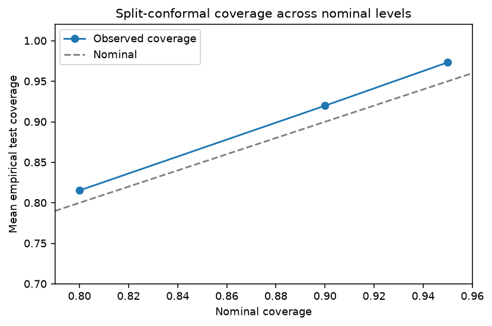

# Calibration and uncertainty report

The frozen run includes Brier score, ten-bin expected calibration error, split-conformal prediction sets and source-only 95th-percentile feature-support thresholds. ECE depends on binning; estimates from small held-out partitions are noisy. Conformal coverage depends on calibration/evaluation exchangeability, which is not established under cohort shift.

## Split-conformal coverage

| nominal_coverage | empirical_coverage_min | empirical_coverage_mean | empirical_coverage_max | average_set_size_mean | group_n |
| --- | --- | --- | --- | --- | --- |
| 0.800 | 0.529 | 0.815 | 0.951 | 1.081 | 114 |
| 0.900 | 0.791 | 0.920 | 1.000 | 1.383 | 114 |
| 0.950 | 0.898 | 0.973 | 1.000 | 1.700 | 114 |

There are 114 task/model/fold combinations per nominal level, including a single official test for SPECTF. Mean empirical coverage is pooled over heterogeneous tasks and must not be read as a global guarantee. Class-conditional coverage and set-size diagnostics are reported per row in `metrics/conformal_metrics.csv`; the 90% level can be compared with the frozen primary table at `metrics/source_conformal_metrics_90.csv`.

No calibrated clinical threshold is established. The uncertainty results support only retrospective method diagnostics.

<!-- DUPLICATE_SAFE_CONFORMAL START -->
## Duplicate-safe conformal sensitivity

For Hungary and VA Long Beach, the exact duplicates were removed before folds and calibration sets were formed. At nominal levels, the mean empirical coverage across the two datasets, six models and three folds is:

- 10%: mean 0.909, range 0.806–1.000

These finite-sample estimates remain conditional on exchangeability; the re-created splits are not the original calibration/test partitions.

## Source-fitted calibration comparison

The supplemental comparison fits Platt, isotonic, beta, and temperature maps on each saved calibration partition, then evaluates on the matching held-out fold or SPECTF official test. No held-out labels fit a calibrator or choose a method. Hungary and VA use duplicate-safe splits; their reconstructed selected-model test probabilities agree with the saved duplicate-safe run to maximum absolute difference `1.11e-16`. The comparison covers 114 task/model/split groups and 570 method-level rows, with 210 task/model/method summaries.

Across the 42 task/model groups, the macro mean changes in pooled Brier, log loss and sample-weighted ten-bin ECE versus raw probabilities were:

| Method | Δ Brier | Δ log loss | Δ weighted ECE | Lower Brier groups |
|---|---:|---:|---:|---:|
| Platt | −0.009 | +0.015 | −0.044 | 28/42 |
| Isotonic | +0.003 | +0.428 | −0.028 | 15/42 |
| Beta | −0.002 | +0.168 | −0.040 | 23/42 |
| Temperature | +0.000 | −0.092 | −0.008 | 22/42 |

These means mask task-level reversals. Platt reduced Brier in most groups and improved weighted ECE on average, but its mean log loss was worse. Temperature scaling had the lowest mean log loss change while leaving Brier nearly unchanged. Isotonic calibration was unstable on small calibration partitions and substantially increased mean log loss. No method dominates across metrics and tasks. Paired fold differences are descriptive; the folds are not independent populations.

Calibration intercept and slope are also retained as descriptive test-set diagnostics. Their unpenalized logistic fit is weakly identified and optimizer-sensitive on some small or nearly separated fold predictions, so the independent metrics-versus-predictions check strictly recalculates ROC-AUC, average precision, Brier, log loss, and both ECE variants; intercept/slope values are only checked for finiteness and should not be used to rank methods.

The calibration partition is also used by the existing split-conformal pipeline. This analysis does not combine recalibrated probabilities with a new conformal quantile or make recalibrated coverage claims; that would require a separate conformal calibration sample or a justified cross-fitting design. Isotonic results should be treated as a high-variance sensitivity comparison.

Machine-readable outputs are in `results/final_research_20261108/calibration_extension/` (`fold_metrics.csv`, `summary_metrics.csv`, `paired_fold_differences.csv`, `fitted_calibration_parameters.csv`, and `manifest.json`). Row-level predictions are local and git-ignored. Re-run with `uv run --locked python -m experiments.run_calibration_extension`. Task-wise reliability figures are under `figures/`; the compact per-task Brier-change figure is `figures/calibration_brier_delta_by_task.pdf`.
<!-- DUPLICATE_SAFE_CONFORMAL END -->
